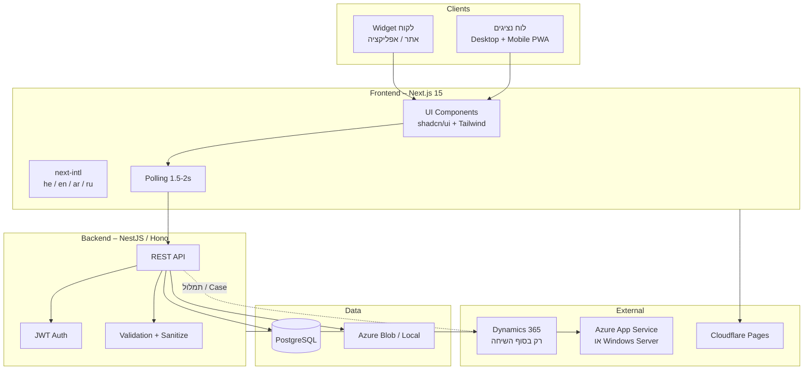
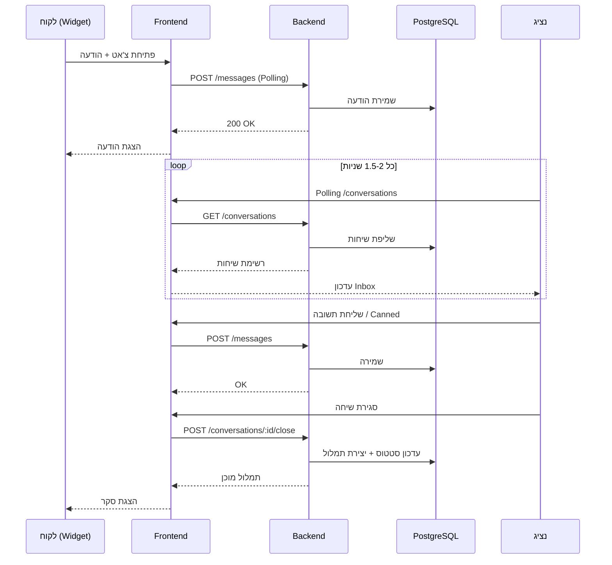

# Chatty – ארכיטקטורה פונקציונלית ותשתית (ויזואלית)
**Ver. 0.5.0 | Build 014 | 04.11.2026**

## 1. תרשים ארכיטקטורה כללית (High-Level)



## 2. זרימת נתונים בשיחה (Sequence)



## 3. מבנה תיקיות מוצע

```
chatty/
├── apps/
│   ├── web/                    # Next.js (Widget + Agent Dashboard)
│   │   ├── app/
│   │   ├── components/
│   │   ├── lib/
│   │   └── messages/           # i18n (he, en, ar, ru)
│   └── api/                    # NestJS Backend
│       ├── src/
│       │   ├── modules/
│       │   │   ├── auth/
│       │   │   ├── conversations/
│       │   │   ├── messages/
│       │   │   ├── canned/
│       │   │   └── agents/
│       │   └── main.ts
├── packages/
│   └── shared/                 # טיפוסים משותפים, constants
├── docs/                       # כל המסמכים
├── docker/
├── .github/workflows/
└── README.md
```

## 4. רכיבי תשתית

| רכיב              | טכנולוגיה                          | הערות                              |
|-------------------|------------------------------------|------------------------------------|
| Frontend          | Next.js 15 + Tailwind + shadcn/ui | Cloudflare Pages (עיקרי)           |
| Backend           | NestJS (מומלץ)                     | Azure App Service / Windows Server |
| Database          | PostgreSQL                         | Azure Database for PostgreSQL      |
| Auth              | JWT                                | פשוט ומאובטח                       |
| Real-time         | Polling 1.5–2 שניות                | ללא WebSockets                     |
| i18n              | next-intl                          | RTL + LTR מלא                      |
| CI/CD             | GitHub Actions                     |                                   |
| קבצים (אופציונלי) | Azure Blob Storage                 |                                   |

## 5. עקרונות טכניים
- קוד נקי, מודולרי, מתועד
- TypeScript בכל מקום
- בדיקות יחידה + אינטגרציה בסיסיות
- Docker לתמיכה קלה
- לוגים מסודרים
- הצגת Ver. / Build / תאריך בכל מסך
- סנכרון מלא 100% ל-Git בכל שינוי

## 6. סביבות
- **Development** – מקומי + Docker
- **Staging** – Cloudflare + Azure
- **Production** – אותו דבר עם הגדרות ייצור
