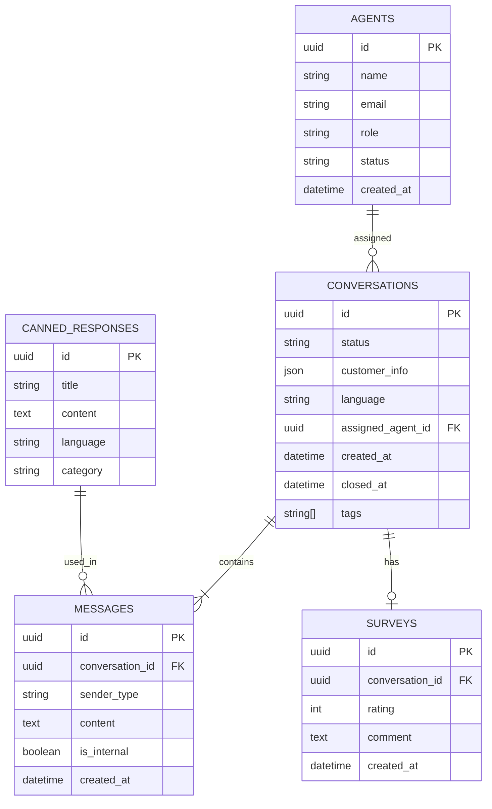

# Chatty – עיצוב טכני מפורט (Technical Design)
**Ver. 0.1.1 | Build 002 | 03.11.2026**

## 1. מודל נתונים (ERD מקוצר)



## 2. API עיקרי (REST)

| Method | Endpoint                          | תיאור                          |
|--------|-----------------------------------|--------------------------------|
| POST   | /auth/login                       | התחברות נציג                   |
| GET    | /conversations                    | רשימת שיחות (עם פילטרים)       |
| GET    | /conversations/:id                | פרטי שיחה + הודעות             |
| POST   | /conversations                    | פתיחת שיחה חדשה                |
| POST   | /conversations/:id/close          | סגירת שיחה + תמלול             |
| POST   | /messages                         | שליחת הודעה                    |
| GET    | /canned-responses                 | רשימת תגובות קבועות            |
| POST   | /surveys                          | שליחת סקר                      |
| GET    | /health                           | בדיקת תקינות                   |

## 3. Polling Strategy
- Frontend שולח GET כל 1500–2000ms
- Backend מחזיר רק שינויים (או ETag / last-updated)
- במקרה של שיחה פעילה – polling תכוף יותר
- במנוחה – polling איטי יותר (לחיסכון)

## 4. i18n
- קבצים: `messages/he.json`, `en.json`, `ar.json`, `ru.json`
- תמיכה מלאה ב-RTL (dir="rtl") ו-LTR
- אפשרות להוספת שפה חדשה על ידי הוספת קובץ בלבד

## 5. הצגת גרסה
קומפוננטה גלובלית:
```
Chatty Ver. {version} | Build {build} | {date}
```
מופיעה בכל מסך (Widget + Dashboard).

## 6. אבטחה
- HTTPS בלבד
- JWT עם expiry קצר
- Rate limiting בסיסי
- Sanitization של כל תוכן משתמש
- CORS מוגדר היטב
- הרשאות לפי תפקיד (RBAC פשוט)

## 7. עיצוב UI (עקרונות)
- פשוט, נקי, אלגנטי
- שימוש ב-shadcn/ui + Tailwind
- צבעים ניטרליים + accent אחד
- תמיכה מלאה במובייל
- נגישות בסיסית (a11y)
